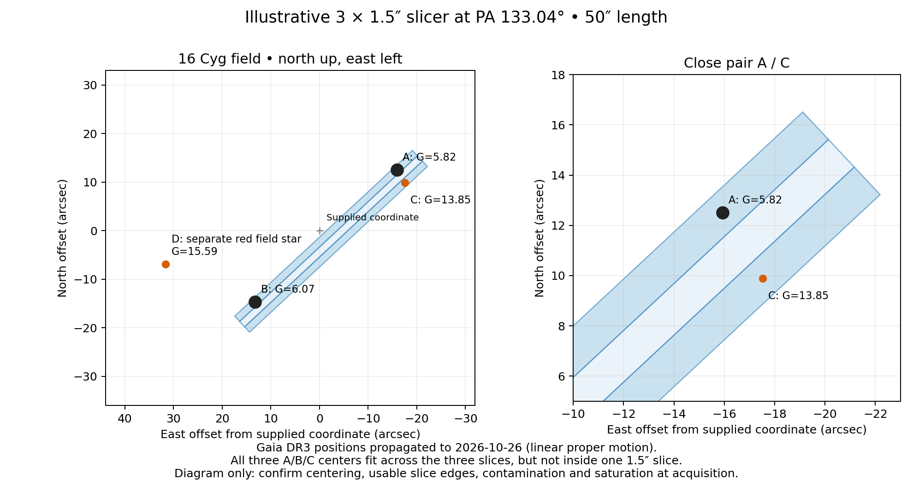

# Z16 Cyg A/B/C — acquisition, October 26

**Reserved 20:03–20:17 PDT (03:03–03:17 UTC October 27).** Third science target (upload row 4 after the opening standard), between H5MUSES-327 and P7344. P6677 moves to 00:57–01:11 PDT October 27. The 40 regular science targets are retained; this is an additional manual visit, bringing tonight to 41 visits. The NGPS upload includes Z16CygABC with 1 x 1 s and fixed slit PA 133.04 degrees.

Airmass 1.124–1.145; minimum Moon separation 84.47 degrees. A 14-minute block is a time reservation, not a prescribed integration. Check progress and stop in time to resume the regular sequence.

## Coordinates and centering

User-supplied ICRS coordinates (position epoch unspecified):

| Position | RA degrees | Dec degrees | RA sexagesimal | Dec sexagesimal |
|---|---:|---:|---|---|
| System center | 295.4592 | +50.5204 | 19:41:50.208 | +50:31:13.440 |
| Z16 Cyg A | 295.4524 | +50.5239 | 19:41:48.576 | +50:31:26.040 |
| Z16 Cyg B | 295.4656 | +50.5167 | 19:41:51.744 | +50:31:00.120 |
| Z16 Cyg C | 295.4516 | +50.5232 | 19:41:48.384 | +50:31:23.520 |

Use the system center to acquire the field, not as a final three-slice centering solution. From these supplied coordinates, the minimum-width A/B/C strip is 39.81 arcsec long and 3.105 arcsec across, at PA 130.63 degrees east of north.

Gaia DR3 positions linearly propagated from epoch 2016.0 to tonight predict PA 133.04 degrees, length 39.90 arcsec and cross-slit width 3.004 arcsec. The propagated B position is 1.99 arcsec from the user-supplied position (A 0.38 arcsec; C 0.23 arcsec). Do not silently mix coordinate epochs. Verify all three in the acquisition view before finalizing angle and centering; orbital curvature/parallax are not modeled in this illustration.

The Gaia-based illustrative slicer center is RA 295.45816048, Dec +50.51978977 (19:41:49.959 +50:31:11.243). The upload uses this initial slicer center; refine alignment on the acquisition image.

## Exposure and extraction

NGPS has three 50-arcsec-long slices. At a width of 1.5 arcsec per slice, the 4.5-arcsec-wide combined footprint can geometrically contain the three centroids with A/B in one outer slice and C in the other. All three do not fit one central 1.5-arcsec slice. Keep 2x3 binning if retaining the run configuration and use matching calibrations for any changed settings. Use a fixed angle established on the acquisition image; the default automatic parallactic angle will not maintain this alignment.

A/B have Gaia G=5.82/6.07 and C G=13.85, a brightness contrast of roughly 1,300–1,600. C is only about 3.07 arcsec from A. Capture does not guarantee a clean C spectrum: assess seeing, scattered light, extraction cross-talk and the calibration of outer slices. The existing single-object central-slice extraction is insufficient.

**User limit: 10 seconds maximum per exposure. All three components are of interest, with C the priority.** The upload starts with 1 x 1 s. Inspect this initial exposure, inspect saturation in every channel, and choose a duration at or below 10 seconds from the result. The ceiling is not a guarantee against saturation. All channels share the exposure time. Do not use the ordinary 300-second galaxy setting. C is much fainter than A/B: assess its trace and contamination directly; repeat unsaturated short exposures within the reserved block if useful. Separate centering may be needed for C. Do not increase an exposure beyond 10 seconds to reach C.

Sources: [NGPS specifications](https://caltechopticalobservatories.github.io/NGPS/technical-specifications.html), [acquisition guide](https://caltechopticalobservatories.github.io/NGPS/users-manual/acquisition-and-guiding.html), [SIMBAD C](https://simbad.cds.unistra.fr/simbad/sim-id?Ident=16+Cyg+C), Gaia DR3 I/355/gaiadr3.
